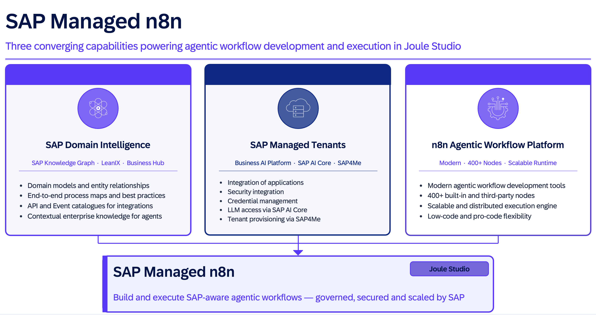

# Session AD164 - Generate agentic workflows using SAP-managed n8n in Joule Studio

## Description

This repository contains the material for the SAP TechEd 2026 session called Session AD164 - Generate agentic workflows using managed service for n8n in Joule Studio.  

## Overview

This session introduces attendees to building and deploying agentic workflows using SAP-managed n8n in Joule Studio.

The scenario is based on a real-world accounts payable use case: an invoice with a payment block exists in SAP S/4HANA Cloud. An AI agent retrieves the invoice and analyses it in the context of the related purchase order, goods receipt, and supplier contract. The agent's findings are presented to an approver through Joule Chat, enabling a conversational experience to review the details and make an informed decision. When the approver approves the invoice, the payment block is automatically removed in SAP S/4HANA Cloud.

SAP Business AI Platform provides agentic workflow capabilities, and n8n is the SAP agentic workflow orchestration solution included in Joule Studio. It leverages n8n as a modern agentic workflow engine, running on scalable and robust SAP infrastructure with AI-driven development using LLMs and SAP knowledge systems.

## Requirements

The requirements to follow the exercises in this repository are:

- SAP Joule Studio
- SAP S/4HANA Public Cloud

## Solution Progression

All three exercises are built around the same Invoice-to-Pay accounts payable scenario. They demonstrate two complementary architectural patterns. In both patterns the AI agent performs analysis only — the human approval step is always a subsequent step in the workflow via SAP Task Center.

**Exercises 1 & 2 — Workflow calls Agent**
An n8n workflow is the entry point. It validates the invoice and calls an AI agent to analyse it against the Purchase Order in S/4HANA Public Cloud. After receiving the agent's analysis, the workflow routes it to an AP Clerk via SAP Task Center for the final approve or reject decision (human in the loop).

**Exercise 3 — Agent triggers Workflow**
An AI agent is the entry point. It retrieves a payment-blocked invoice from S/4HANA Public Cloud and performs a 3-way match against the Purchase Order, Goods Receipt, and Supplier Contract. The agent's findings then trigger an n8n workflow that delivers the analysis to an AP Clerk via SAP Task Center for the final approve or reject decision (human in the loop).

| | Exercises 1 & 2 | Exercise 3 |
|---|---|---|
| **Entry point** | n8n Workflow | AI Agent or Joule Chat |
| **S/4HANA data** | Invoice , Purchase Order | Invoice · Purchase Order|
| **Human decision** | AP Clerk via SAP Task Center | AP Clerk via SAP Task Center |
| **Outcome** | Invoice approved / rejected | Invoice approved / rejected|

## Exercises

- [Exercise 1 - Create a Workflow, Deploy and Test](exercises/ex1/)
    - [Exercise 1.1 - Build the Workflow](exercises/ex1#exercise-11---build-the-workflow)
    - [Exercise 1.2 - Deploy and Test the Workflow](exercises/ex1#exercise-12---deploy-and-test-the-workflow)
- [Exercise 2 - Create an Agent and Use it as a Step in the Workflow, Deploy and Test](exercises/ex2/)
    - [Exercise 2.1 - Build the Agent](exercises/ex2#exercise-21---build-the-agent)
    - [Exercise 2.2 - Deploy and Test the Extended Solution](exercises/ex2#exercise-22---test-the-extended-solution)
- [Exercise 3 - Create Agent and Workflow in the Same Solution, Deploy and Test](exercises/ex3/)
    - [Exercise 3.1 - Build the Agent](exercises/ex3#exercise-31---build-the-agent)
    - [Exercise 3.2 - Deploy and Test the Solution](exercises/ex3#exercise-32---deploy-and-test-the-solution)

## Contributing
Please read the [CONTRIBUTING.md](./CONTRIBUTING.md) to understand the contribution guidelines.

## Code of Conduct
Please read the [SAP Open Source Code of Conduct](https://github.com/SAP-samples/.github/blob/main/CODE_OF_CONDUCT.md).

## How to obtain support

Support for the content in this repository is available during the actual time of the online session for which this content has been designed. Otherwise, you may request support via the [Issues](../../issues) tab.

## License
Copyright (20xx-)20xx SAP SE or an SAP affiliate company and <your-project> contributors. Please see our [LICENSE](LICENSE) for copyright and license information. Detailed information including third-party components and their licensing/copyright information is available [via the REUSE tool](https://api.reuse.software/info/github.com/SAP/<your-project>).
