# Session AD164 - Generate agentic workflows using SAP-managed n8n in Joule Studio

## Description

This repository contains the material for the SAP TechEd 2026 session called Session AD164 - Generate agentic workflows using SAP-managed n8n in Joule Studio.  

## Overview

This session introduces attendees to building and deploying agentic workflows using SAP-managed n8n in Joule Studio.

The scenario is based on a real-world accounts payable use case: an invoice with a payment block exists in SAP S/4HANA Cloud. An AI agent retrieves the invoice and analyses it in the context of the related purchase order, goods receipt, and supplier contract. The agent's findings are presented to an approver through Joule Chat, enabling a conversational experience to review the details and make an informed decision. When the approver approves the invoice, the payment block is automatically removed in SAP S/4HANA Cloud.

SAP Business AI Platform provides agentic workflow capabilities, and n8n is the SAP agentic workflow orchestration solution included in Joule Studio. It leverages n8n as a modern agentic workflow engine, running on scalable and robust SAP infrastructure with AI-driven development using LLMs and SAP knowledge systems.

## Requirements

The requirements to follow the exercises in this repository are:

- SAP Joule Studio
- SAP S/4HANA Public Cloud

## Exercises

- [Exercise 1 - Create an Invoice Approval Workflow](exercises/ex1/)
    - [Exercise 1.1 - Build the Workflow](exercises/ex1#exercise-11---build-the-workflow)
    - [Exercise 1.2 - Deploy and Test the Workflow](exercises/ex1#exercise-12---deploy-and-test-the-workflow)
- [Exercise 2 - Build and Deploy an Invoice PO Validation AI Agent](exercises/ex2/)
    - [Exercise 2.1 - Build the Agent](exercises/ex2#exercise-21---build-the-agent)
    - [Exercise 2.2 - Test the Extended Solution](exercises/ex2#exercise-22---test-the-extended-solution)
- [Exercise 3 - Build and Deploy an AP Invoice Payment Block Processing Agent](exercises/ex3/)
    - [Exercise 3.1 - Build the Agent](exercises/ex3#exercise-31---build-the-agent)
    - [Exercise 3.2 - Deploy and Test the Solution](exercises/ex3#exercise-32---deploy-and-test-the-solution)

## Solution Progression

The three exercises build progressively on the same accounts payable scenario — from a simple workflow with a human decision step, through adding AI analysis to an existing workflow, to building a fully autonomous AI agent that drives the process end to end.

```mermaid
flowchart TB

    subgraph EX1 ["Exercise 1 — Invoice Approval Workflow"]
        direction LR
        A1(Invoice Data) --> B1[n8n: Validate Invoice] --> C1[SAP Task Center] --> D1{AP Clerk\nApprove / Reject} --> E1(Result Returned)
    end

    subgraph EX2 ["Exercise 2 — Adds a PO Validation Agent to the Exercise 1 Workflow"]
        direction LR
        A2(Invoice Data) --> B2[n8n: Validate Invoice] --> C2["AI Agent\nInvoice vs PO"] --> D2["SAP Task Center\n+ Agent Analysis"] --> E2{AP Clerk\nApprove / Reject} --> F2(Result Returned)
        S2[(S/4HANA\nPurchase Order)] -. query .-> C2
    end

    subgraph EX3 ["Exercise 3 — New Solution: AP Invoice Payment Block Processing"]
        direction LR
        S3[(S/4HANA\nInvoice · PO · GR · Contract)] --> B3["AI Agent\n3-Way Match"] --> C3["n8n Workflow\nAgent Findings"] --> D3["SAP Task Center\n+ Analysis"] --> E3{AP Clerk\nApprove / Reject} --> F3("Payment Block\nReleased / Kept")
    end
```

| | Exercise 1 | Exercise 2 | Exercise 3 |
|---|---|---|---|
| **Type** | n8n Workflow | n8n Workflow + AI Agent | AI Agent + n8n Workflow |
| **Input** | Invoice header data | Invoice header data | Blocked invoice in S/4HANA |
| **S/4HANA data** | — | Purchase Order | Invoice · PO · Goods Receipt · Purchasing Info Record |
| **AI** | — | Invoice vs PO comparison | 3-way match: Invoice × PO × GR × Contract |
| **Assets built** | 1 | 4 (workflow + agent + 2 MCP servers) | 7 (agent + workflow + 5 MCP servers) |
| **Outcome** | Approve / Reject | Approve / Reject + PO analysis | Approve / Reject + payment block released |

## Contributing
Please read the [CONTRIBUTING.md](./CONTRIBUTING.md) to understand the contribution guidelines.

## Code of Conduct
Please read the [SAP Open Source Code of Conduct](https://github.com/SAP-samples/.github/blob/main/CODE_OF_CONDUCT.md).

## How to obtain support

Support for the content in this repository is available during the actual time of the online session for which this content has been designed. Otherwise, you may request support via the [Issues](../../issues) tab.

## License
Copyright (20xx-)20xx SAP SE or an SAP affiliate company and <your-project> contributors. Please see our [LICENSE](LICENSE) for copyright and license information. Detailed information including third-party components and their licensing/copyright information is available [via the REUSE tool](https://api.reuse.software/info/github.com/SAP/<your-project>).
