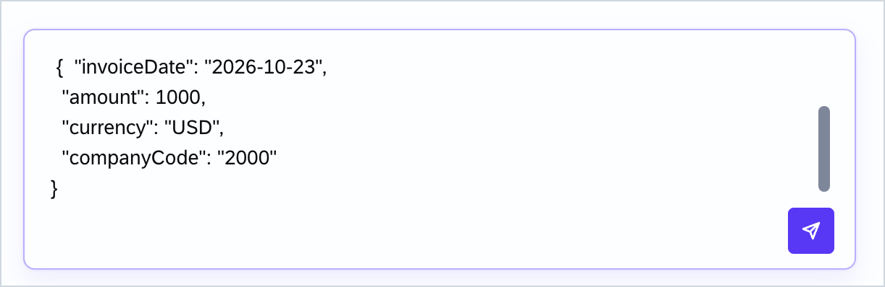

# Exercise 1 - Create an Invoice Approval Workflow

In this exercise, you will use SAP Joule Studio to create an agentic invoice approval workflow powered by SAP-managed n8n. You will describe what you want in plain business language (an *intent*), refine the requirements through a guided Q&A with the AI **Webagent**, generate the workflow specification and solution, and then deploy and test it.

> **New to Joule Studio or n8n? Start here.**
> - **SAP Joule Studio** — SAP's environment for building, deploying, and managing AI-powered automations and agents.
> - **SAP-managed n8n** — a visual, node-based workflow engine hosted and run by SAP. You build a process as a series of connected steps called *nodes*.
> - **Webagent** — the AI assistant that turns your plain-language *intent* into a working solution by asking you a few clarifying questions.
> - **Solution** — the container for your work. It holds one or more **assets** (a workflow, an agent, or an MCP server) and is the unit you deploy. A solution can also be shared, committed to a GitHub repository, and transported to another Joule Studio tenant.
> - **Intent** — a description of the business outcome you want, in everyday language — no technical terms required.
>
> **Throughout this guide, the action you need to perform is shown in bold.** Steps marked *(Review only)* need no action — just look and move on.

## Exercise 1.1 - Build the Workflow

After completing these steps you will have built an invoice approval workflow that validates invoices, routes them to an AP Clerk for approval via email and Teams notifications, and logs the outcome.

1. **Log on to SAP Joule Studio** in your browser using the credentials shared by your trainers.
<br>

2. You arrive on the **Joule Studio home screen**, which opens with the **Joule Chat** interface. *(Review only — get oriented.)*
<br>

3. In the left navigation, **click Solutions** to open the Solutions area.
> A **solution** groups one or more **assets** (a workflow, agent, or MCP server) and is what you ultimately deploy.
<br>

4. **Click New** to start creating a solution.
<br>

5. **Select n8n Workflow** as the type for your new solution.
> You're telling Joule Studio to build this solution as a visual n8n workflow (a sequence of connected nodes).
<br>

6. **Paste the intent statement below into the Intent field**, optionally add a **Solution name** (use your username), then **click Create**.
> Your **intent** is simply the business outcome you want. The Webagent translates it into requirement and specification documents using SAP knowledge systems and SAP LeanIX, then builds the solution for you — you don't need to write any technical detail here.
    ```
    Please create a workflow. The workflow should...Receive Invoice data as input, do basic validation of each line item of the invoice. Submit the invoice for an approval to a AP clerk for approval. AP Clerk receive Mail and Teams notifications. AP Clerk approve or reject the invoice.
    ```
<br>

7. The Webagent now asks clarifying questions about the trigger, validation, and approver. **Enter the following answer and submit it:**
    ```
    webhook call. validation of amount, currency, due date. AP Clerk - provide your user email id. AP Clerk approve using Task Center. Post approval the log the outcome and workflow ends
    ```
<br>

8. The next question is about the approval-task behaviour and your business KPI (how you'll measure success). **Enter the following answer and submit it:**
    ```
    reduce manual processing and ensure 100% invoices are validated
    ```
<br>

9. For the question about the AP Clerk as approver, **select all applicable options and click Submit Answer**.
<br>

10. **Select all remaining options and click Submit Answer**.
<br>

11. **Enter your AP Clerk email ID** — use your own email address so the approval task appears in your own workspace.
<br>

12. When asked what happens if the AP Clerk rejects an invoice, **choose "Log only - record outcome and end"**.
<br>

13. **Review and confirm the refined intent** together with the Key Business Goals.
<br>

14. **Review and confirm the Business Goals and Success Criteria**, then proceed.
<br>

15. **Click Generate Requirements** to have the Webagent produce the workflow requirements.
<br>

16. **Review the generated requirements and confirm them.**
<br>

17. The Webagent creates a requirements document. **Read through it carefully, then click Generate Specification.**
<br>

18. **Read through the generated specification, then click Generate Solution.**
<br>

19. **Review the workflow overview, then click Invoice-approval-workflow** to open the n8n workflow editor.
<br>
<br>

20. In the n8n editor, **delete the Outlook and MS Teams notification nodes**.
> This Joule Studio tenant isn't connected to a Teams or Outlook tenant, so those notification steps can't run in this exercise. To delete a node, select it and press Delete (or use its right-click menu).
<br>

21. This is your final workflow model, ready to deploy. *(Review only.)*
<br>

## Exercise 1.2 - Deploy and Test the Workflow

After completing these steps you will have deployed your workflow and run it end to end with sample data.

1. **Click Deploy**, then **click Deploy again** in the confirmation dialog.
<br>

2. A toast message confirms that deployment has started. **Click View deployment history.**
<br>

3. **Click View logs** to follow the deployment progress.
<br>

4. The log confirms your invoice approval workflow deployed successfully. *(Review only.)*
<br>

5. Deployment success also appears under **Manage → Deployments** in the Job History, with the **Solution status shown as Running**. *(Review only.)*
<br>

6. In the **Try Deployed Solution** section, **select your workflow** (for example, invoice-approval-workflow), then **generate test data** by typing a prompt such as "Generate test data" or "provide input values for this workflow".
> A deployed workflow needs input to run. Here the Webagent creates realistic sample invoice data so you don't have to craft it by hand.
<br>

7. **Copy the JSON produced by the Webagent, paste it into the input text area, and click the action button.**
<br>

8. The input is validated against the generated input schema. *(Review only.)*
<br>

9. **Type "confirm" and click the action button.**
<br>

10. **Click Execute Workflow.**
<br>

11. A success message appears with a link to monitoring. **Click the link.**
<br>

12. Monitoring opens the execution details. **Select the workflow instance** to see its execution history.
<br>

13. **Review the execution history** to see each step the workflow ran. *(Review only.)*
<br>

## Summary

You have successfully built, deployed, and tested an invoice approval workflow in Joule Studio using SAP-managed n8n. The workflow validates incoming invoices, routes them for approval to an AP Clerk, and logs the outcome.

Continue to - [Exercise 2 - Create and Deploy a Custom Agent](../ex2/README.md)
