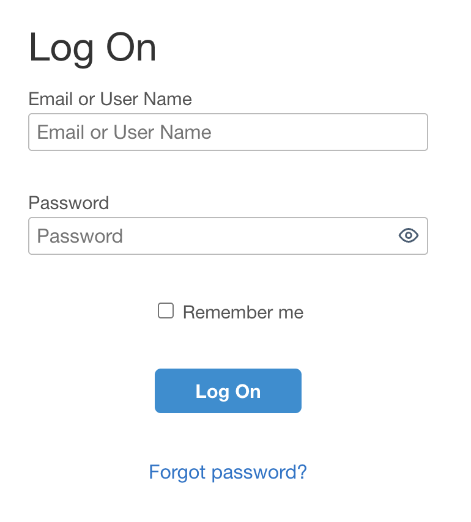
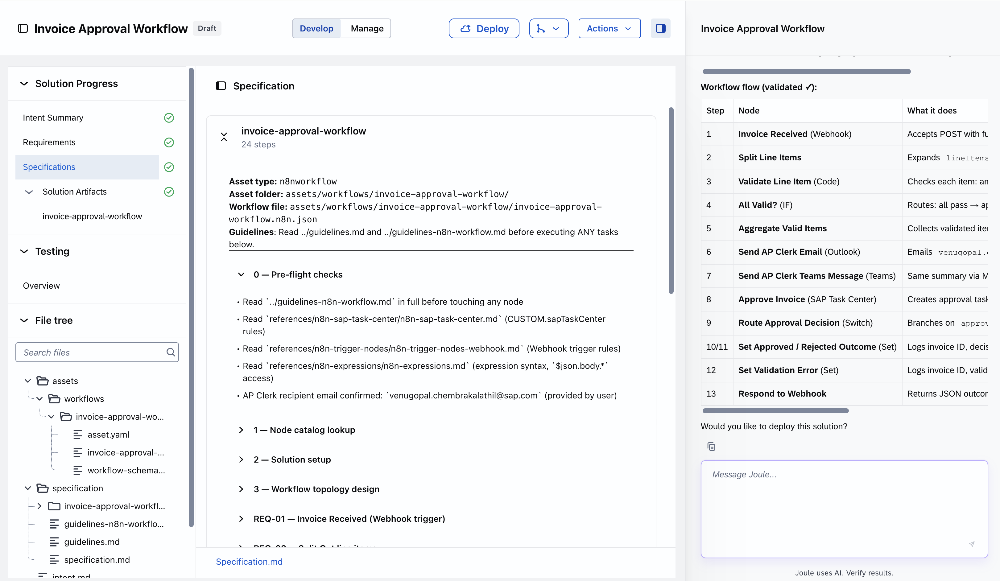

# Exercise 1 - Create an Invoice Approval Workflow

In this exercise, you will use Joule Studio to create an agentic invoice approval workflow powered by SAP-managed n8n. You will define the intent, refine requirements through a guided Q&A with the AI Webagent, generate the workflow specification and solution, and deploy it.

## Exercise 1.1 - Build the Workflow, Deploy and Test

After completing these steps you will have created and deployed an invoice approval workflow that validates invoices, routes them for AP Clerk approval via email and Teams notifications, and logs the outcome.

1. Open your browser and log on to Joule Studio using the credentials shared by your trainers.
<br>

2. You are now on the Joule Studio home screen with the Joule Chat interface.
<br>

3. In the left navigation, click on **Solutions** to open the Solutions section.A solution consists of multiple assets, each asset represents a deployable entity. For eg: In this exercise A workflow, agent or mcp server are assets part of a solution. A solution can be shared, commit to a Github repository and transport to another Joule studio tenant. It is also a deployable artifact in Joule studio.
<br>

4. Click **New** to create a new solution.
<br>

5. Select **n8n Workflow** as the workflow type for your new solution.
<br>

6. Copy and paste the intent statement below into the **Intent** field. Optionally provide a **Solution name** using your username. Click **Create**. A intent could be a business requirement to solve a specific business problem and a user could express this in business language without having any technical terms. The Business intent is translated in product requirement and specification documents using SAP knowledge systems and Lean IX integrated to Joule studio tenant. A reviewed specification document is used to build a solution by the webagent using various technical artifacts as files.
    ```
    Please create a workflow. The workflow should...Receive Invoice data as input, do basic validation of each line item of the invoice. Submit the invoice for an approval to a AP clerk for approval. AP Clerk receive Mail and Teams notifications. AP Clerk approve or reject the invoice.
    ```
<br>

7. The Webagent will ask a series of questions to refine the workflow requirements. For the first set of questions about trigger, validation, and approver setup, provide the following answers:
    ```
    webhook call. validation of amount, currency, due date. AP Clerk - provide your user email id. AP Clerk approve using Task Center. Post approval the log the outcome and workflow ends
    ```
<br>

8. The next question is related to approval task behaviour and success criteria as a business KPI. Enter the following answer and submit:
    ```
    reduce manual processing and ensure 100% invoices are validated
    ```
<br>

9. The next question is related to the AP Clerk as approver. Select all applicable options and click **Submit Answer**.
<br>

10. Select all remaining options and click **Submit Answer**.
<br>

11. Enter your **AP Clerk email ID** — use your user email address so that you get an approval task in your workspace.
<br>

12. When asked what happens when the AP Clerk rejects an invoice, choose **Log only - record outcome and end**.
<br>

13. Review and confirm the refined intent together with the Key Business Goals.
<br>

14. Review and confirm the Business Goals and Success Criteria, then proceed.
<br>

15. Click the **Generate Requirements** button to generate the workflow requirements.
<br>

16. Review the generated requirements and confirm them.
<br>

17. The Webagent has created a requirements document. Read through it carefully and click **Generate Specification**.
<br>

18. Read through the generated specification and click **Generate Solution**.
<br>

19. Review the generated workflow overview. Click on **Invoice-approval-workflow** to open the n8n workflow editor.
<br>
<br>

20. In the n8n workflow editor, delete the **Outlook** and **MS Teams** notification nodes. The Joule studio tenant has not integrated with a MS Teams or Outlook tenant, hence it is not possibel to use this functionality in this exercise.
<br>

21. This is the final workflow model ready for deployment.
<br>

22. Click the **Deploy** action and confirm by clicking the **Deploy** button in the confirmation dialog.
<br>

23. A toast message confirms that deployment has started. Click **View deployment history**.
<br>

24. Click **View logs** to monitor deployment progress.
<br>

25. The log confirms a successful deployment of your invoice approval workflow.
<br>

## Summary

You have successfully created and deployed an invoice approval workflow in Joule Studio using SAP-managed n8n. The workflow validates incoming invoices, routes them for approval to an AP Clerk, and logs the outcome.

Continue to - [Exercise 2 - Create and Deploy a Custom Agent](../ex2/README.md)
