# Exercise 2 - Build and Deploy an Invoice PO Validation AI Agent

In this exercise, you extend the invoice approval workflow from Exercise 1 with a new AI agent that validates supplier invoices against Purchase Orders in S/4HANA Public Cloud. The agent identifies block reasons and enriches the AP clerk's SAP Task Center approval task with a structured analysis — reducing their review time from 20 minutes to 5 minutes per invoice.

As in Exercise 1, you describe what you want in plain business language and the Webagent builds it for you. This time it creates three new assets and extends your existing workflow:

- **`invoice-po-validation-agent`** — a Python A2A agent that queries S/4HANA Public Cloud via two OData APIs
- **`sap-s4-api-supplierinvoice-process-srv-mcp-server`** — MCP server wrapping the Supplier Invoice API
- **`sap-s4-ce-purchaseorder-0001-mcp-server`** — MCP server wrapping the Purchase Order API
- **Updated `invoice-approval-workflow`** — your n8n workflow from Exercise 1, extended with a new "Validate Invoice Against PO" node between the validation and approval steps

> **Throughout this guide, the action you need to perform is shown in bold.** Steps marked *(Review only)* need no action — just look and move on.

## Exercise 2.1 - Build the Agent

After completing these steps you will have built and deployed an AI agent that validates invoices against POs and an extended workflow that calls it automatically.

1. Return to the **Develop** tab of your solution (AD164-0XX) in Joule Studio. In the Webagent chat area, **paste the following intent and send it**:
    ```
    Create a new custom agent, validate the Invoice with related purchase Order in S/4 HANA Public Cloud and provide the reason for invoice block. The AP Clerk approval task get the agent analysis to make a decision in the approval task.
    ```
<br>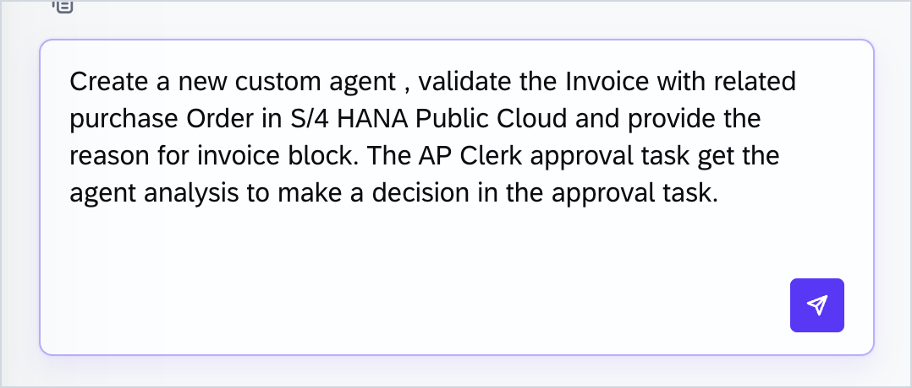

2. The Webagent asks for the primary business outcome this agent should deliver. **Type the following and send it**:
    ```
    Reduce time spent by AP clerks reviewing blocked invoices from 20 minutes to 5 minutes per invoice
    ```
<br>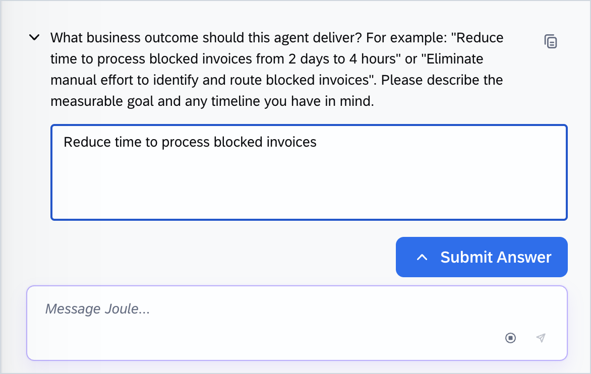

3. The Webagent presents a **Business Goals & Success Criteria** table (Metric: AP Clerk invoice review time, Baseline: 20 min, Target: 5 min). *(Review only — confirm the goal and target match your intent.)*
<br>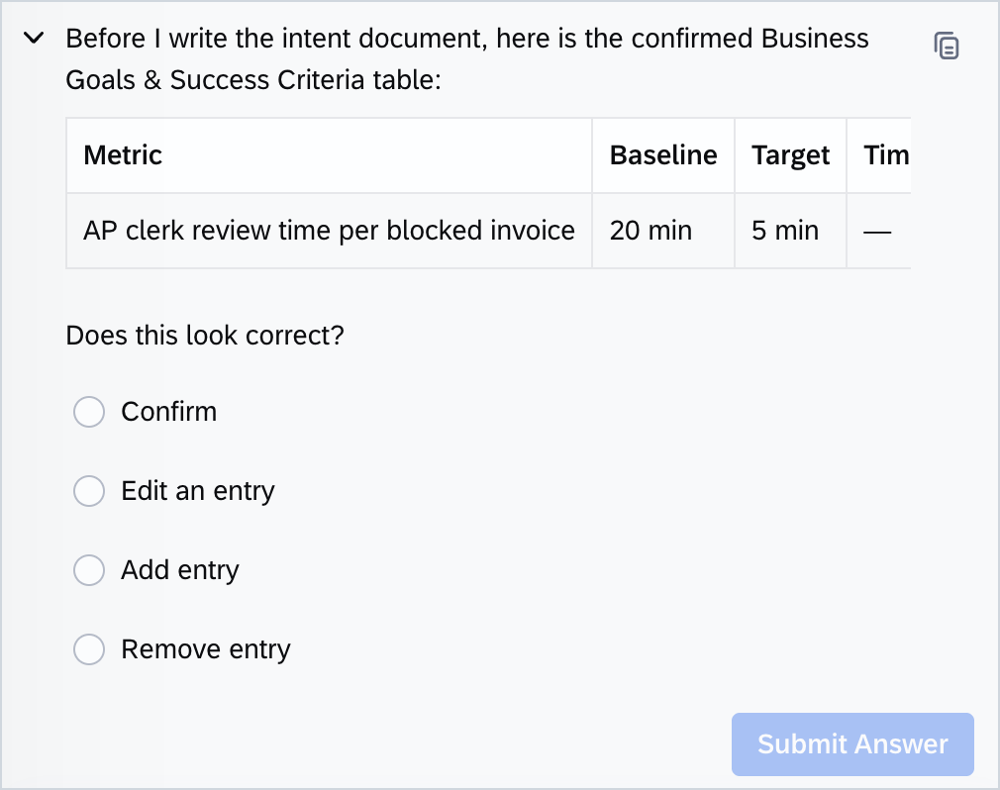

4. **Select "Confirm — proceed"** and **click Submit Answer** to accept the business goal.
<br>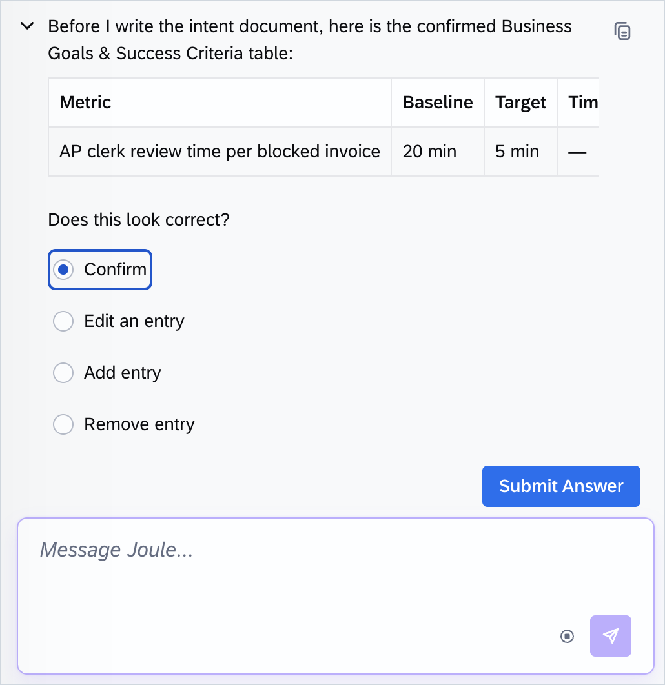

5. The Webagent shows a full **Intent Analysis Summary**: Business Challenge, Goals, what will be built (a new AI Agent + Extended n8n Workflow), the two OData APIs to be used, and a Solution Fit score of 90%. **Type `Yes`** and **send it** to proceed to the Product Requirements Document (PRD).
<br>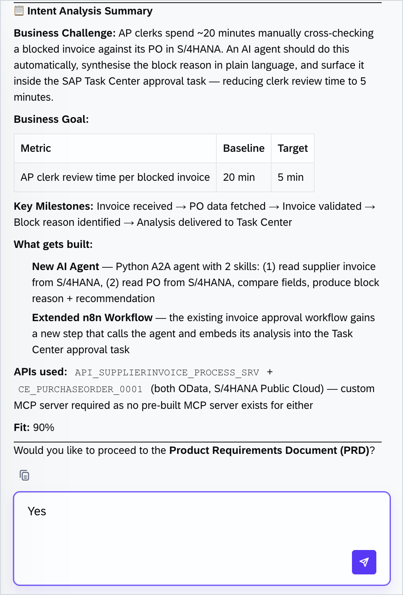

6. The Webagent presents the **Solution Architecture** diagram and **Scope Boundaries** for the Invoice PO Validation AI Agent. *(Review only — familiarise yourself with the design.)* **Type `confirm`** and **send it** to write the PRD.
<br>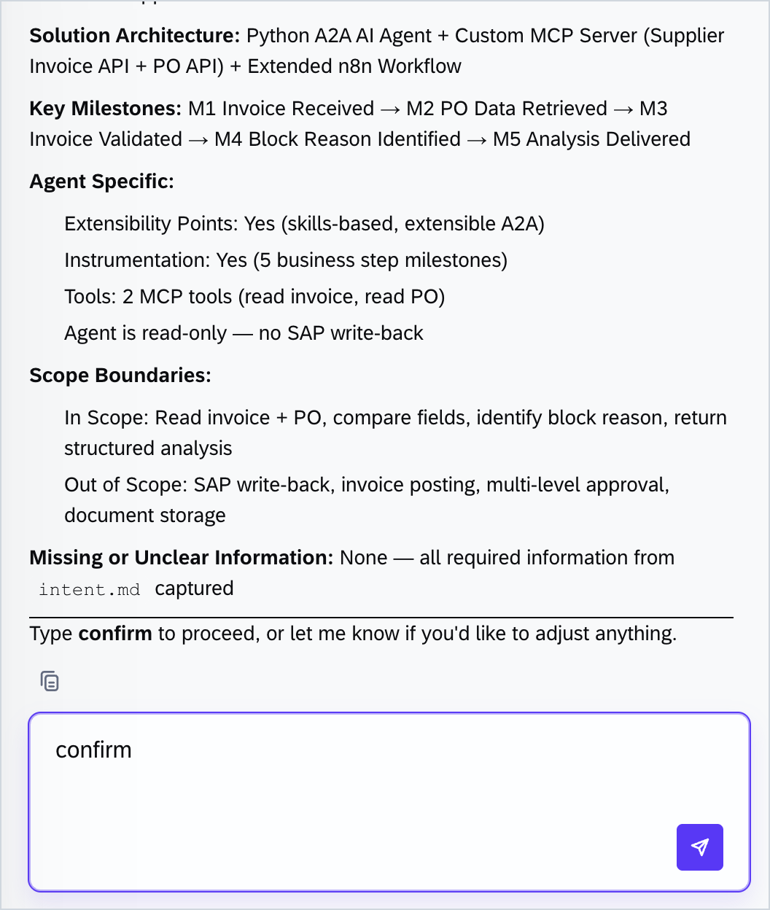

7. The Webagent saves `product-requirements-document.md` and names the solution **"Invoice PO Validation AI Agent"**. It asks whether to proceed to the **specification phase**. **Type `Yes`** and **send it**.
<br>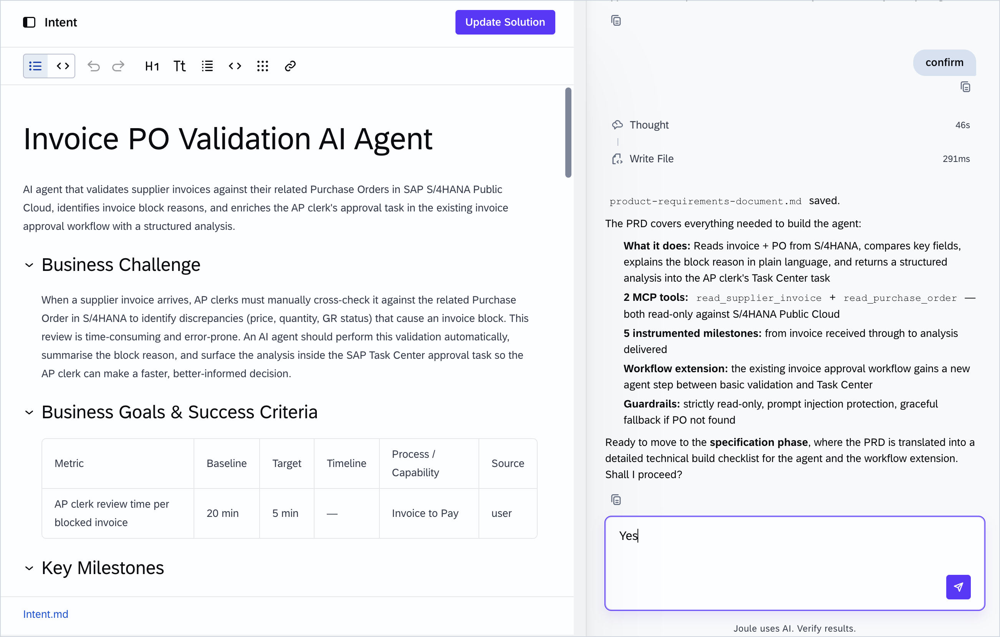

8. The Webagent produces the **Specification Summary** listing two build targets: `invoice-po-validation-agent` (Python A2A agent) and the extended `invoice-approval-workflow` (n8n). *(Review only — check the build targets match expectations.)*
<br>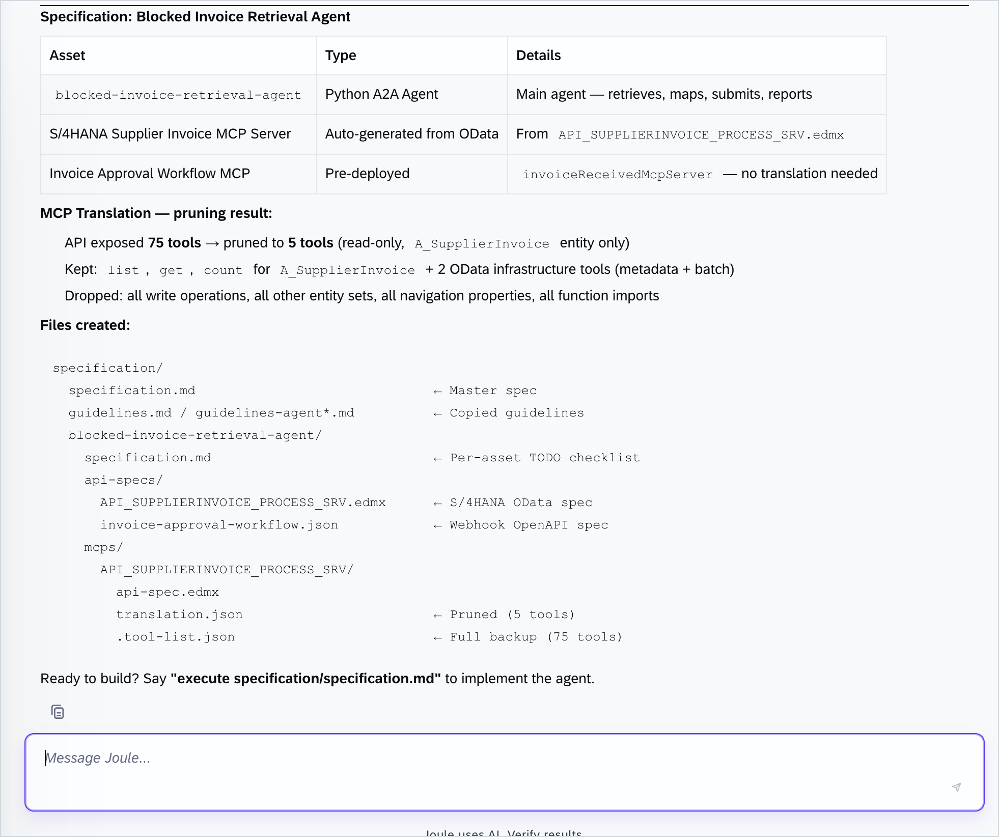

9. The Webagent confirms the specification is ready to execute. **Type `Yes`** and **send it** to start the build.
<br>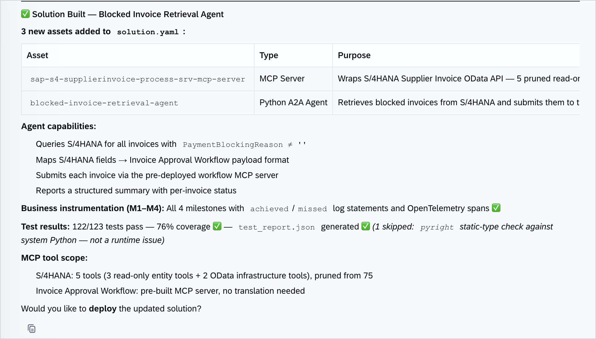

10. The Webagent builds the solution. When it finishes, the **"Invoice PO Validation Agent — Complete ✅"** message appears. It reports **4 assets created** and **121 tests passing**. **Type `deploy`** and **send it** to deploy the solution.
<br>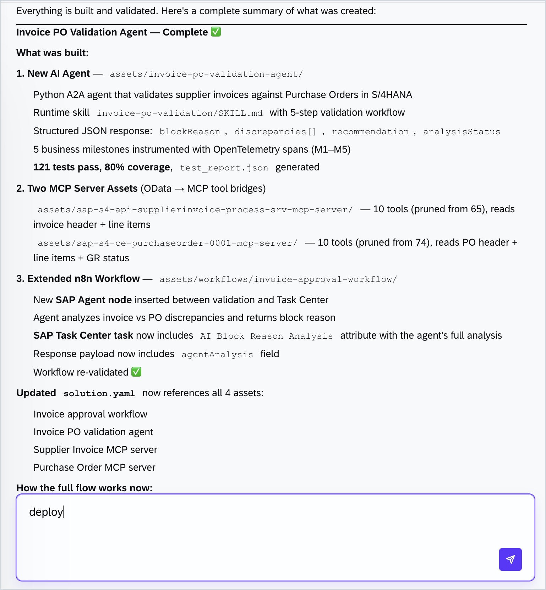

11. The **Manage** tab opens automatically after deployment. The solution **AD164-0XX** shows status **Running** (version 1.0.0+snapshot.2) with all four assets running: `invoice-approval-workflow`, `invoice-po-validation-agent`, `sap-s4-api-supplierinvoice-process-srv-mcp-server`, and `sap-s4-ce-purchaseorder-0001-mcp-server`. *(Review only — confirm all assets show Running.)*
<br>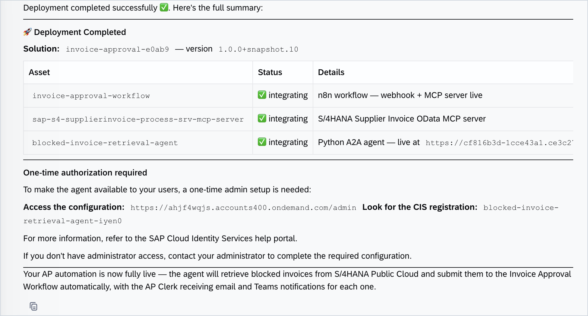

12. In the left panel under **Monitoring & Analytics**, **click `invoice-approval-workflow`** to open the n8n workflow editor. You can see the extended workflow: the new **"Validate Invoice Against PO"** SAP Agent node has been inserted between the Validate Invoice and Approve Invoice nodes. *(Review only — observe how the AI agent fits into the flow.)*
<br>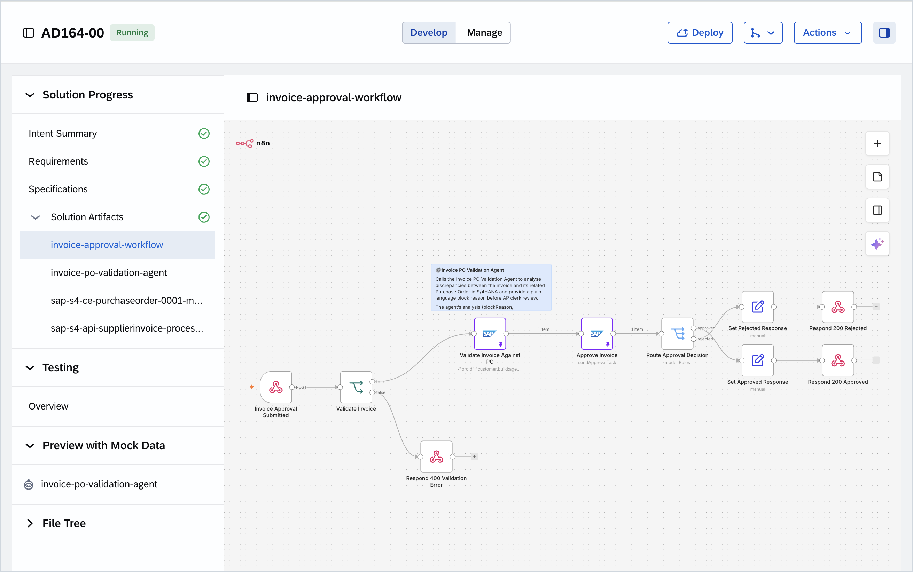

## Exercise 2.2 - Test the Extended Solution

After completing these steps you will have run the end-to-end workflow, confirmed the AI agent's PO validation ran, and checked for the resulting task in SAP Task Center.

1. In the **Manage** tab under **Try Deployed Solution**, **click `invoice-po-validation-agent`** to open the agent's test interface. In the input field, **type `5108417282/2026`** (an invoice number / fiscal year) and **send it** to test the agent standalone.
<br>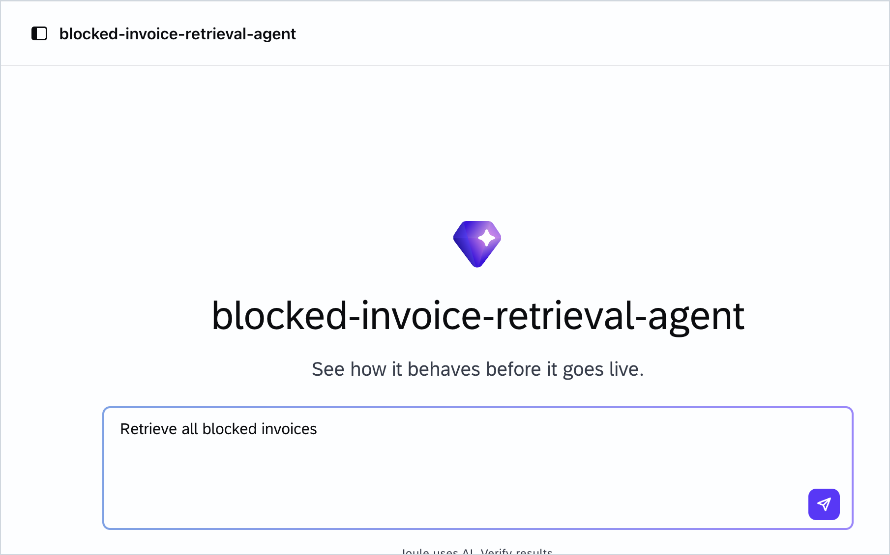

2. The agent responds with a structured **Supplier Invoice Details** report for invoice **5108417282** (fiscal year 2026): Header Information (Invoice Number, Fiscal Year, Supplier Invoice ID: DEMO-BLK-002, Company Code: 1010, Supplier: 10100088, Invoice Status: Posted, Approval Status: Workflow not yet started) and Financial Details (Gross Amount: 514.87 AED). *(Review only — this confirms the agent can query S/4HANA and return invoice data.)*
<br>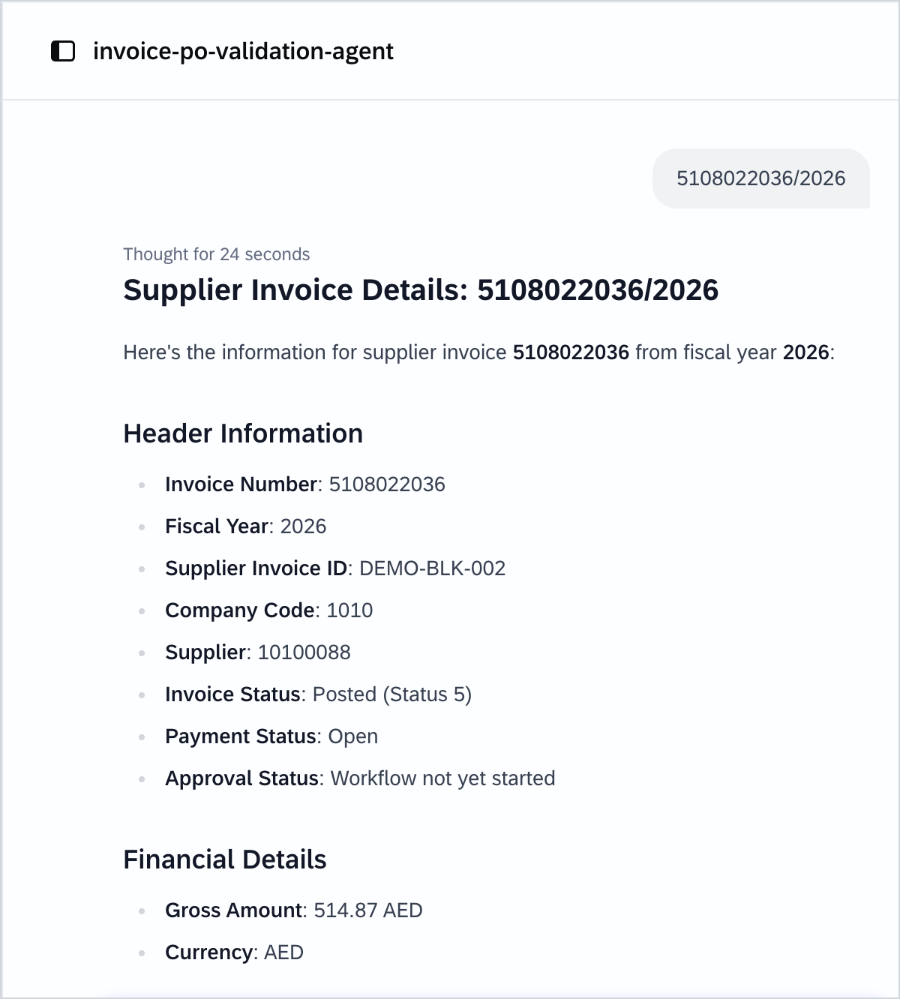

3. Now test the full end-to-end workflow. Under **Try Deployed Solution**, **click `invoice-approval-workflow`**. The Webagent tells you the workflow needs: Invoice Number, Invoice Date, Vendor, Amount, Currency, and Company Code. **Enter the following JSON** in the input field and **send it**:
    ```json
    {
      "invoiceNumber": "5108417282",
      "vendor": "Acme Corp",
      "invoiceDate": "2026-10-23",
      "amount": 12500.00,
      "currency": "EUR",
      "companyCode": "1000"
    }
    ```
<br>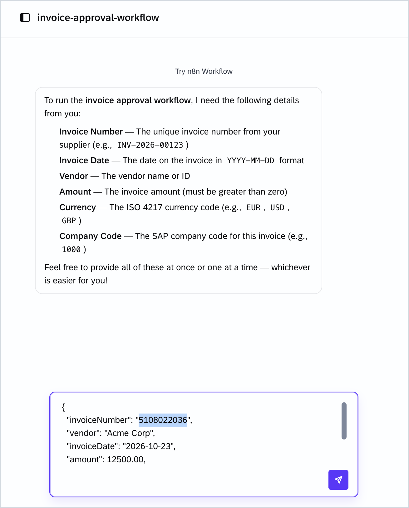

4. The Webagent shows a **summary table** of the invoice data to be submitted (Invoice Number: 5108417282, Vendor: Acme Corp, Invoice Date: 2026-10-23, Amount: 12500, Currency: EUR, Company Code: 1000). **Type `Yes`** and **send it** to confirm.
<br>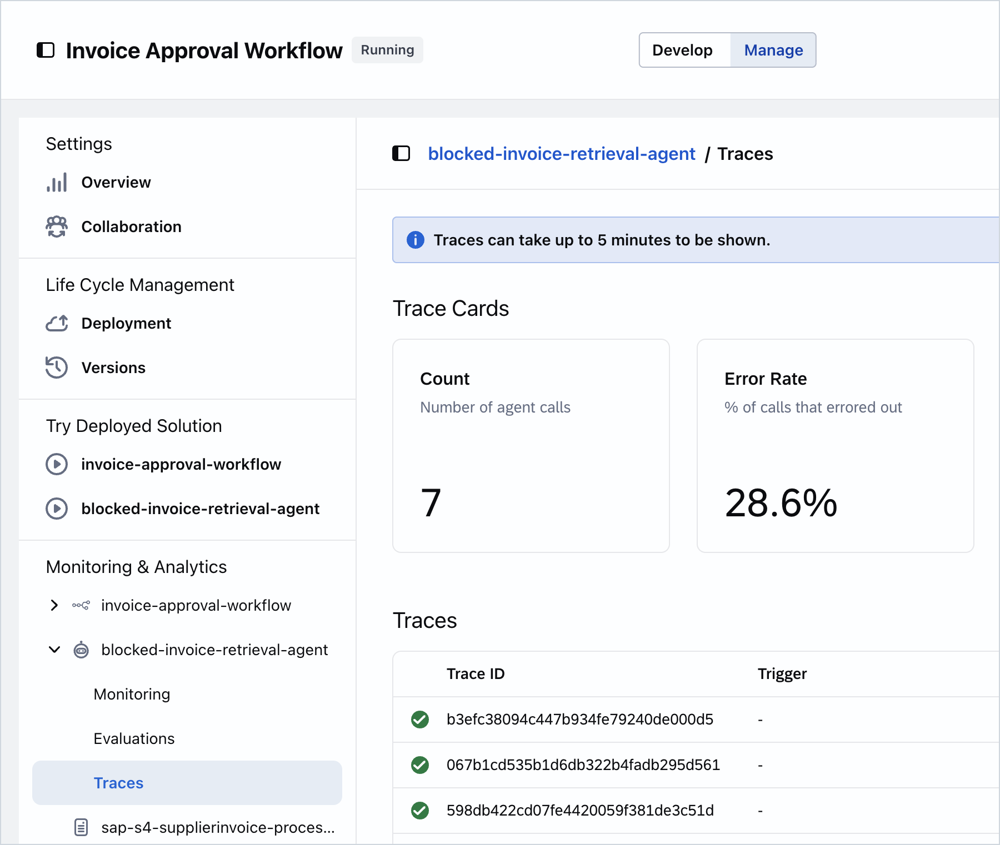

5. The Webagent confirms **"Great, triggering the workflow now!"** and shows an **Execute Workflow** button. **Click "Execute Workflow"** to run the extended invoice approval workflow.
<br>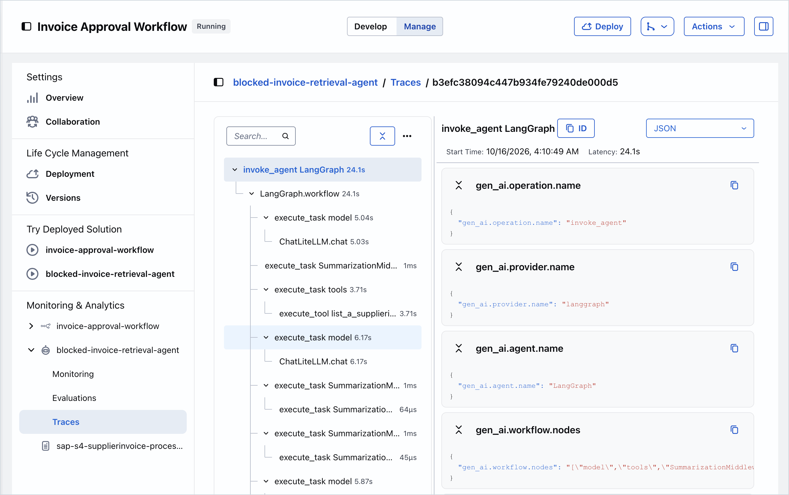

6. The Webagent confirms **"Workflow started successfully!"** with a link to the Monitoring section. **Click "Monitoring section"** to view the execution.
<br>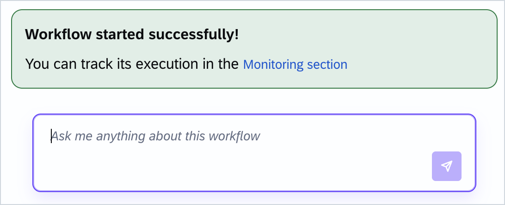

7. The **Workflow Executions** screen shows execution **1661** with status **"waiting"** (duration 7.81 s). The workflow has validated the invoice, called the PO validation agent, and created an approval task in SAP Task Center — it is now waiting for the AP clerk's decision. *(Review only.)*
<br>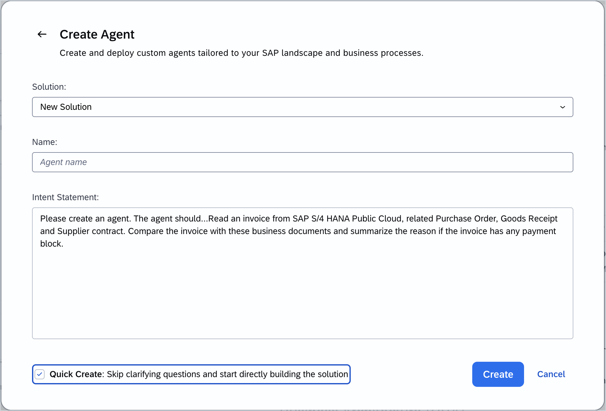

8. **Click execution row 1661** to open its detail view. The step trace shows: Invoice Approval Submitted (2 ms) → Validate Invoice (66 ms) → **Validate Invoice Against PO** (4.3 s — the AI agent ran) → Approve Invoice (3.42 s, waiting). *(Review only — the 4.3 s step is your new AI agent calling S/4HANA.)*
<br>
> The workflow pauses here until the AP clerk acts on the enriched task in SAP Task Center. The agent's PO analysis is attached to the task to help them decide.

9. In the left navigation bar, **click the Conversations icon** (speech-bubble icon) to open Joule Chat.
<br>

10. The Joule Chat screen opens. **Type `List my tasks`** and **send it** to see the pending AP clerk approval task — now enriched with the PO validation analysis — assigned to you in SAP Task Center.
<br>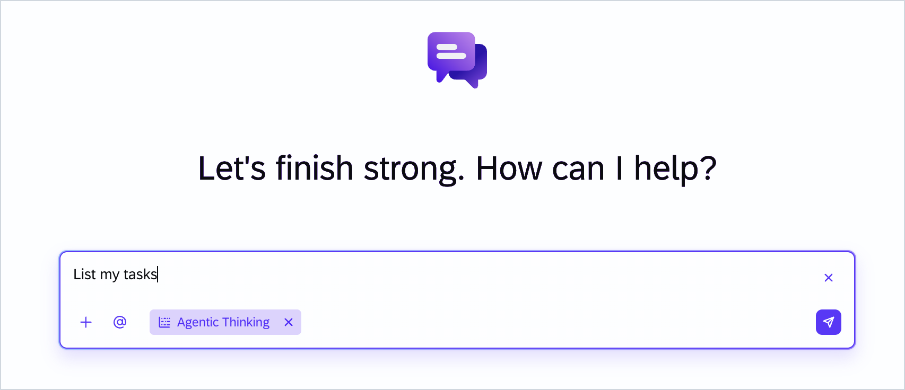

11. SAP Task Center opens showing your **Open Tasks** list. Locate the task **"Invoice Approval: 5108022036 from 0010100088"** (created recently, Medium Priority) and **click "Select"** to open it.
<br>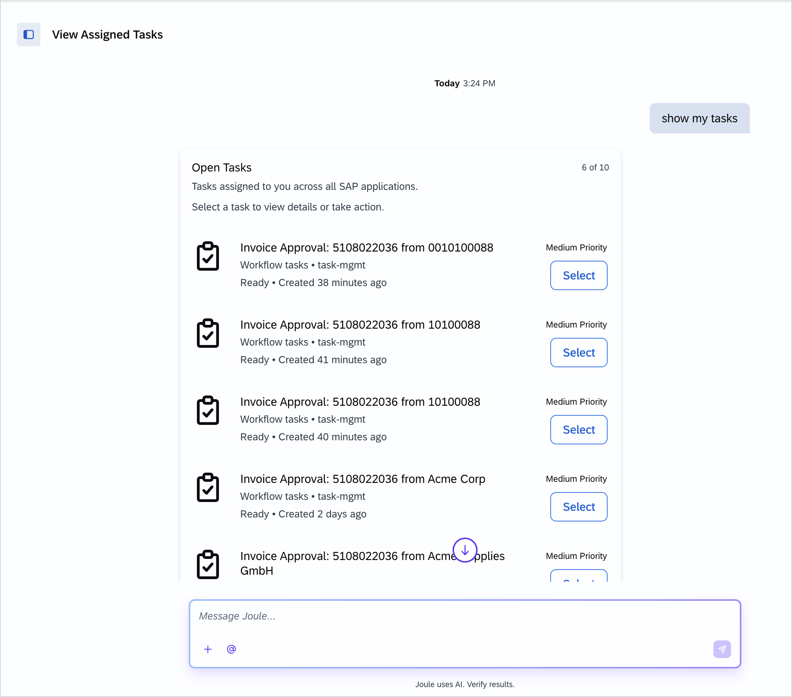

12. The task detail opens showing the **Task Summary** enriched with the agent's analysis: Invoice Number (5108022036), Vendor (0010100088), Amount (514.87 AED), Company Code (1010), AI Block Reason Analysis, and Invoice Date. *(Review only — note the AI Block Reason Analysis field populated by the agent.)* **Click "Approve"** to approve the invoice.
<br>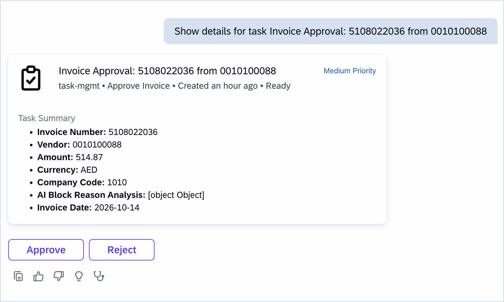

13. A **"Confirm your response"** dialog appears: *"Do you want to approve this task?"* **Click "Acknowledge"** to confirm the approval decision.
<br>

14. SAP Task Center confirms **"Task completed successfully! What would you like to do next?"** The invoice has been approved. *(Review only — the approval decision has been sent back to the workflow.)*
<br>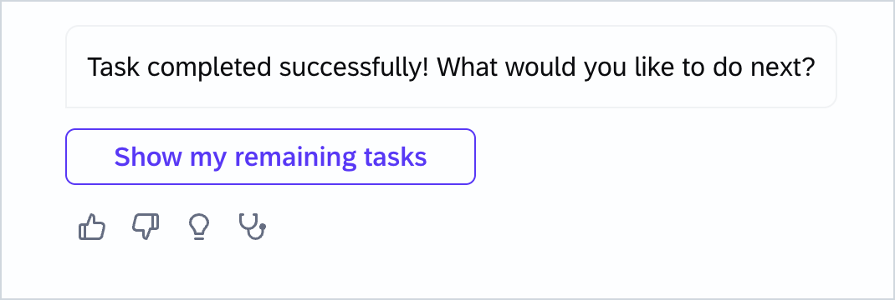

15. Return to Joule Studio. Navigate to **Manage → Monitoring & Analytics → invoice-approval-workflow → Monitoring**. The **Monitoring Cards** now show execution **1794** with status **Success** (total duration ~50 minutes — the time the workflow waited for the AP clerk's approval decision). *(Review only — confirm execution 1794 shows Success.)*
<br>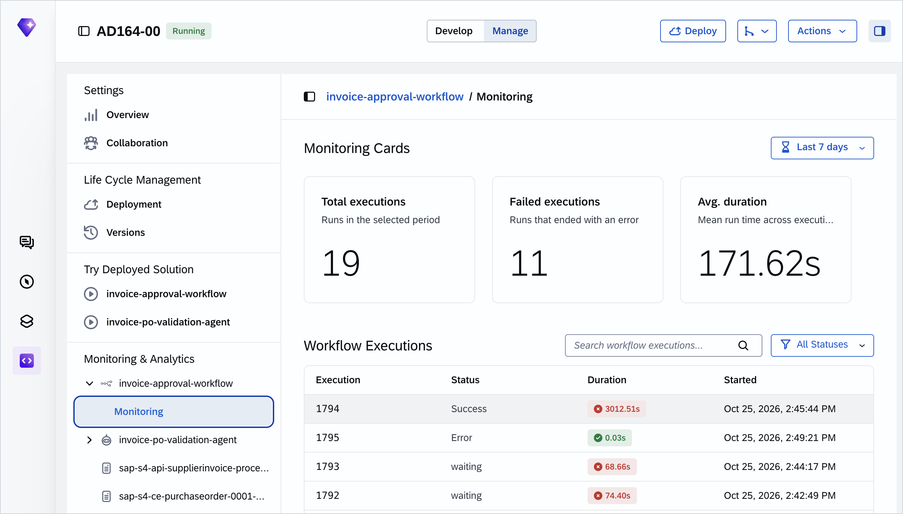

16. **Click execution row 1794** to view the complete step trace: Invoice Approval Submitted (1 ms) → Validate Invoice (10 ms) → **Validate Invoice Against PO** (1 m 39 s — the AI agent queried S/4HANA) → Approve Invoice (48 m 33 s — waiting for the AP clerk) → Route Approval Decision (8 ms) → Set Approved Response (18 ms) → Respond 200 Approved (11 ms). The final status is **`{ "status": "success" }`**. *(Review only — the end-to-end workflow is complete.)*
<br>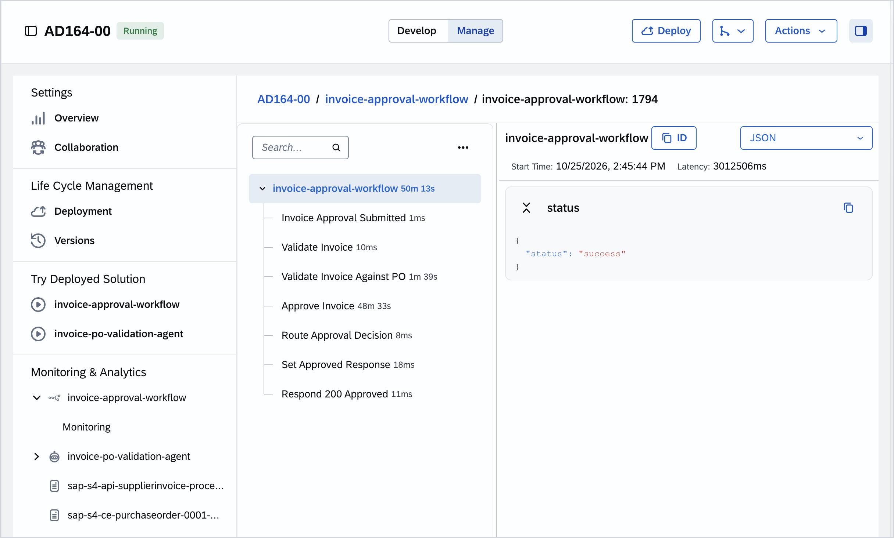

## Summary

You have successfully built, deployed, and tested an Invoice PO Validation AI Agent in Joule Studio. The Webagent generated a Python A2A agent, two custom MCP servers for S/4HANA Public Cloud, and extended your n8n workflow — all from a plain-language intent. The extended workflow now calls the agent automatically on every invoice submission, enriching the AP clerk's approval task with a structured PO analysis.
