# Exercise 3 - Build and Deploy an AP Invoice Payment Block Processing Workflow with Custom Agent

In this exercise you build a complete **AP Invoice Payment Block Processing** solution from scratch. An AI agent performs a 3-way match — comparing a payment-blocked invoice against the related Purchase Order, Goods Receipt, and Purchasing Info Record in S/4HANA Public Cloud — and returns a structured recommendation. The recommendation triggers an n8n approval workflow that sends the analysis to an AP Clerk via SAP Task Center for a final approve or reject decision.

This exercise uses a different entry point: the unified **"What do you want to create?"** dialog, where you describe your intent directly in a chat input rather than filling in a separate form.

**What gets built (7 assets):**
- **`invoice-payment-block-agent`** — AI Agent with a `three-way-match` runtime skill and M1–M3 OpenTelemetry milestones
- **`invoice-approval-workflow`** — n8n Workflow (11 nodes: Blocked Invoice Received → Extract Agent Payload → SAP Task Center → Route Decision → Set Approved/Rejected Outcome)
- **5 Custom MCP Servers** — bridging the agent to 4 S/4HANA Public Cloud OData APIs (Supplier Invoice, Purchase Order, Goods Receipt, Purchasing Info Record) plus the workflow itself

> **Throughout this guide, the action you need to perform is shown in bold.** Steps marked *(Review only)* need no action — just look and move on.

## Exercise 3.1 - Build the Solution with Workflow and Agent

After completing these steps you will have a fully built and ready-to-deploy solution.

1. In Joule Studio, **click Solutions** in the left navigation to open the Solutions area. **Click "+ New"** to start creating a new solution.
<br>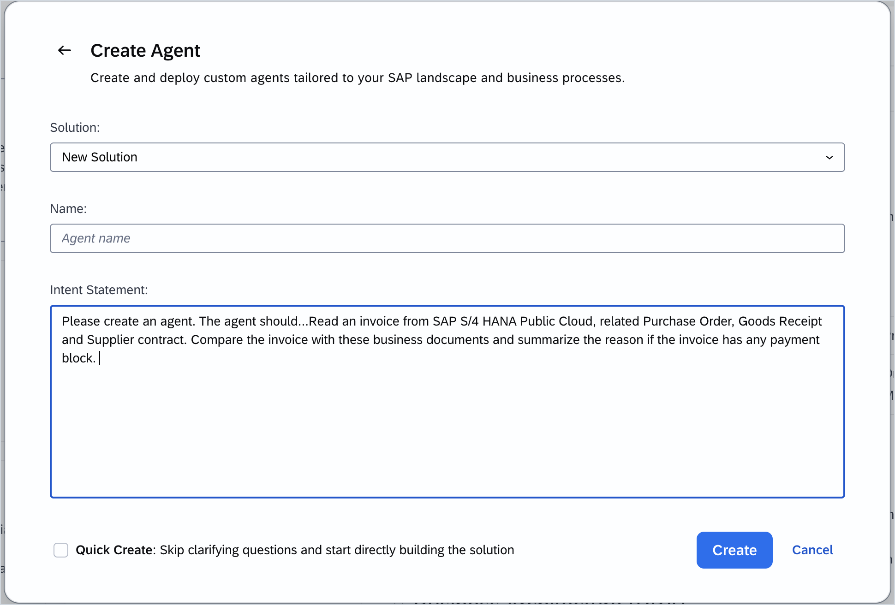

2. The **"What do you want to create?"** dialog opens. In the chat input at the bottom, **paste the following intent and send it**:
    ```
    Business users want to process invoices with payment block in S/4 HANA Public Cloud. A custom agent retrieve an invoice, compare with the related Purchase Order.The response of the agent is triggering an approval workflow. The workflow enable an AP clerk to approve the invoice based on agent analysis.
    ```
<br>
> The **Guided** mode is selected by default. It walks you through the solution design step by step, asking targeted questions to capture your requirements precisely.

3. The Webagent confirms it has analysed your landscape and asks for business goals. **Enter the following and click Submit Answer**:
    ```
    Metric: "Reduce time to clear payment-blocked invoices"
    Baseline: "5 days average today"
    Target: "Under 1 day"
    ```
<br>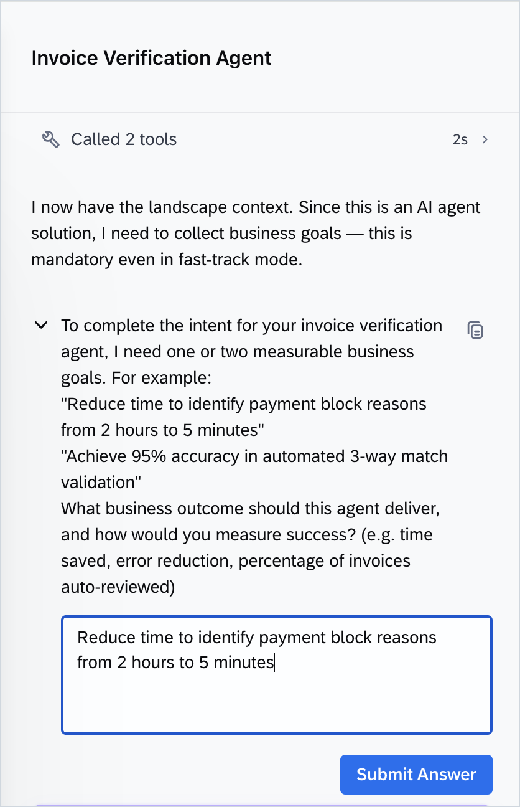

4. The Webagent shows the confirmed **Business Goals & Success Criteria** table (Metric: Reduce time to clear payment-blocked invoices). **Select "Confirm"** and **click Submit Answer**.
<br>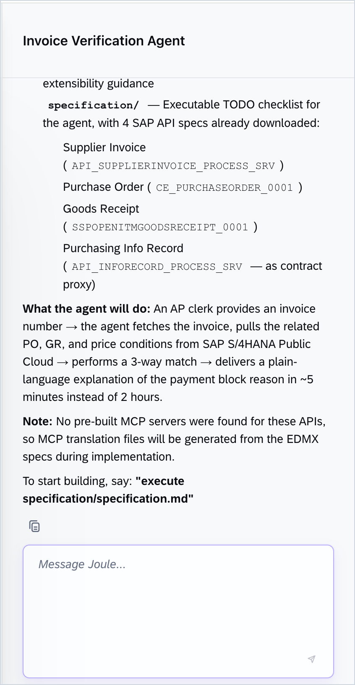

5. The intent document (`intent.md`) is saved and the solution is named **"AP Invoice Payment Block Processing"**. The Webagent proposes 3 core assets: AI Agent, n8n Approval Workflow, and a Custom MCP Server. *(Review only — note the two known gaps: the Supplier Contract API is unavailable, so the Purchasing Info Record will be used as a proxy; the Payment Block Codes API is also unavailable.)* **Type `Yes`** and **send it** to proceed to the Product Requirements Document.
<br>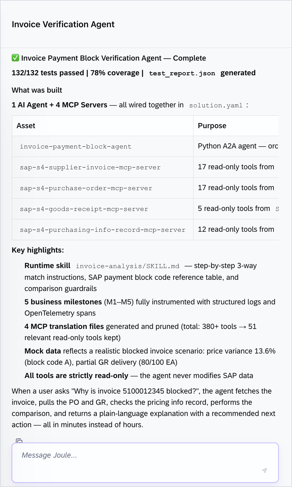

6. The Webagent presents the **PRD summary**. **Select "Confirm — write the PRD"** and **click Submit Answer**.
<br>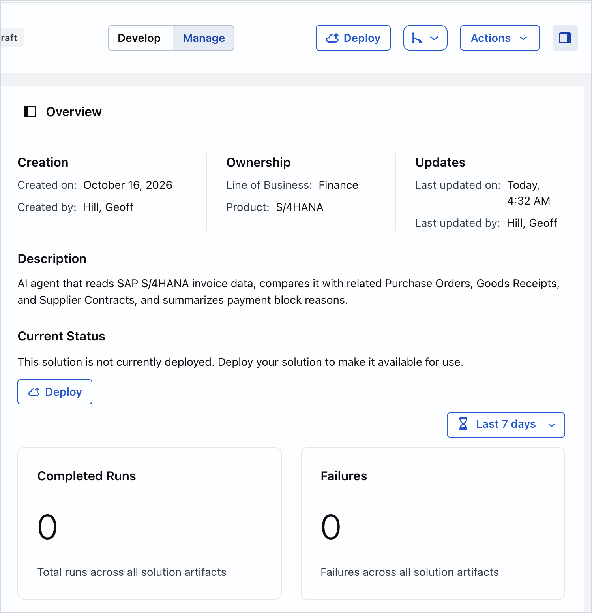

7. The **Product Requirements Document** (`product-requirements-document.md`) is saved. The Webagent summarises the 3 core assets, 7 must-have requirements, 2 known gaps addressed, and guardrails (the agent never releases payments autonomously — all financial actions require AP Clerk approval). *(Review only.)* **Type `build specification`** and **send it** to generate the technical specification.
<br>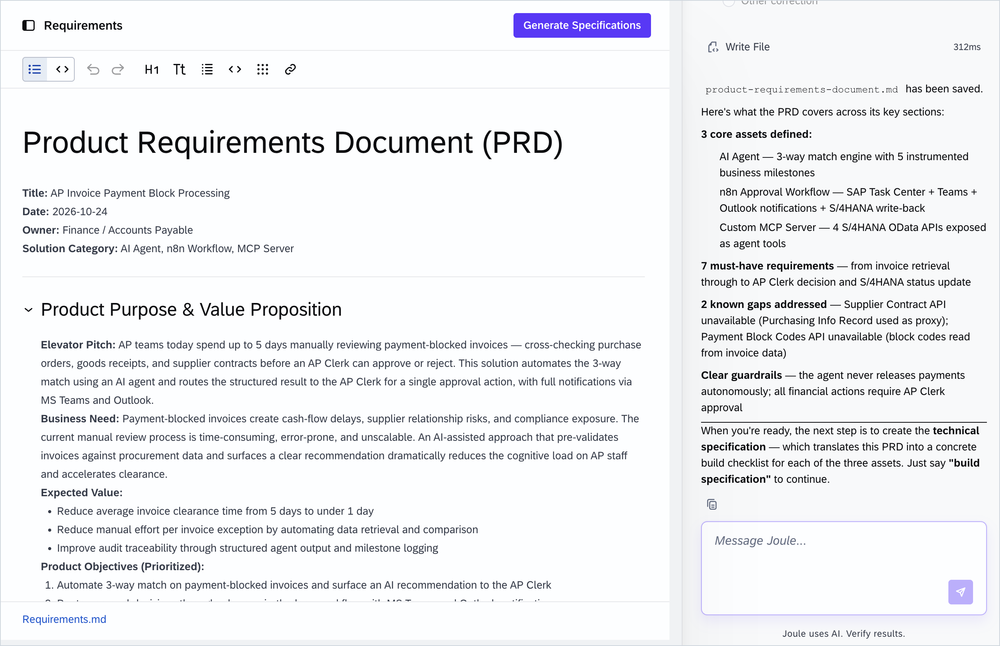

8. The **Specification** document is ready, listing the "Invoice Payment Block Processing Agent" build steps and 4 S/4HANA API specs downloaded. **Click "Generate Solution"** to start the build.
<br>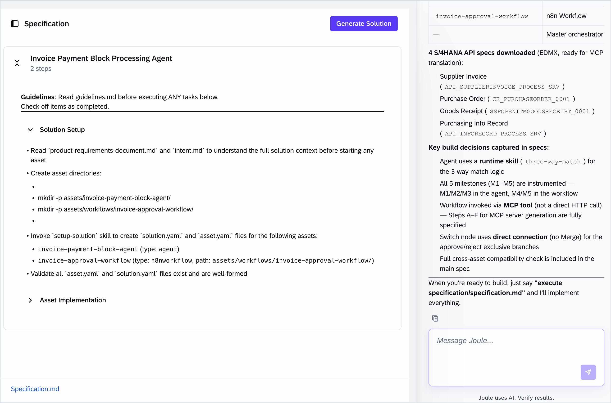

9. The Webagent builds the solution. When complete, the **Solution Progress** panel confirms all phases (Intent Summary ✓, Requirements ✓, Specifications ✓, Solution Artifacts ✓). The generated n8n **`invoice-approval-workflow`** opens in the editor — it includes Teams and Outlook notification nodes alongside the SAP Task Center approval step. *(Review only — take a moment to explore the generated workflow and the 7 solution artifacts in the left panel.)*
<br>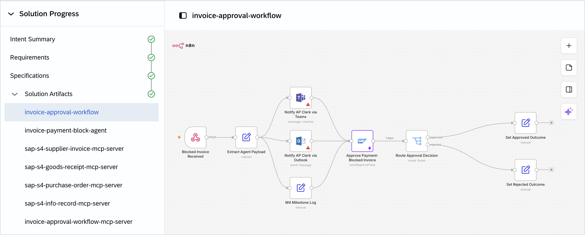

10. This tenant is not connected to a Microsoft 365 tenant, so the Teams and Outlook nodes cannot run. **Select the "Notify AP Clerk via Teams" node** and **click Delete** (or press the Delete key).
<br>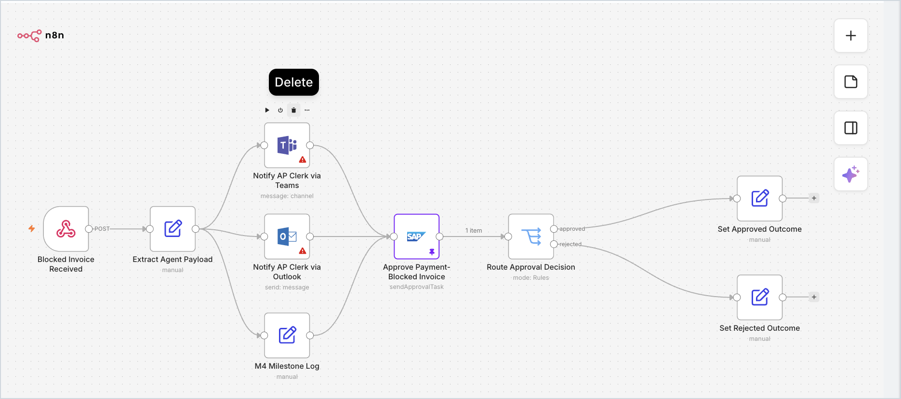

11. **Select the "Notify AP Clerk via Outlook" node** and **click Delete** (or press the Delete key).
<br>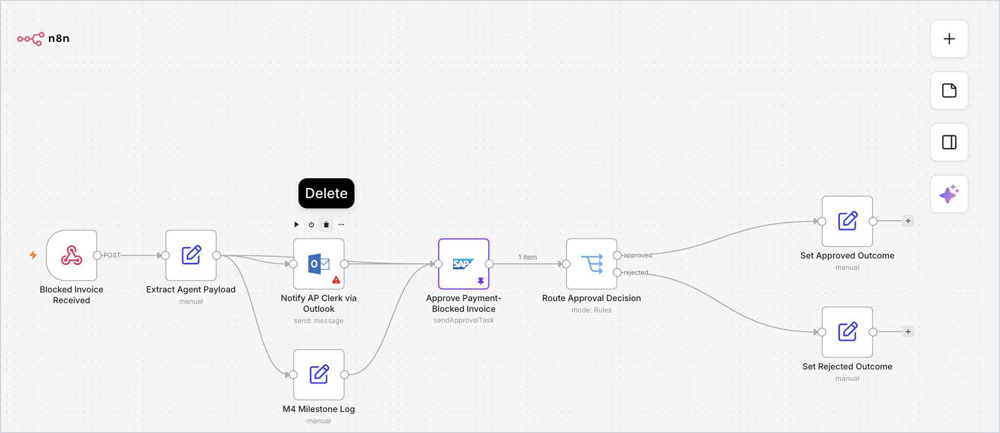

12. Both notification nodes are removed. The simplified workflow now shows: Blocked Invoice Received → Extract Agent Payload → M4 Milestone Log → Approve Payment-Blocked Invoice → Route Approval Decision → Set Approved Outcome / Set Rejected Outcome. *(Review only — confirm the workflow looks clean.)*
<br>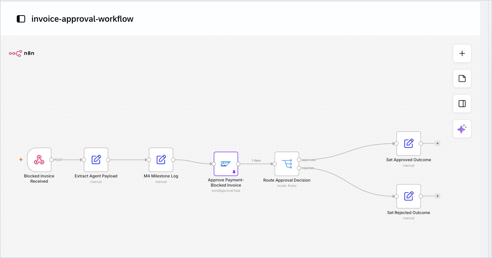

13. The Webagent shows the build summary: **AI Agent** (three-way-match runtime skill, M1–M3 milestones), **n8n Workflow** (11 nodes), **5 MCP servers** (22 tools, 134 tests, 100% pass rate, 74% coverage). **Type `deploy`** and **send it** to deploy the solution.
<br>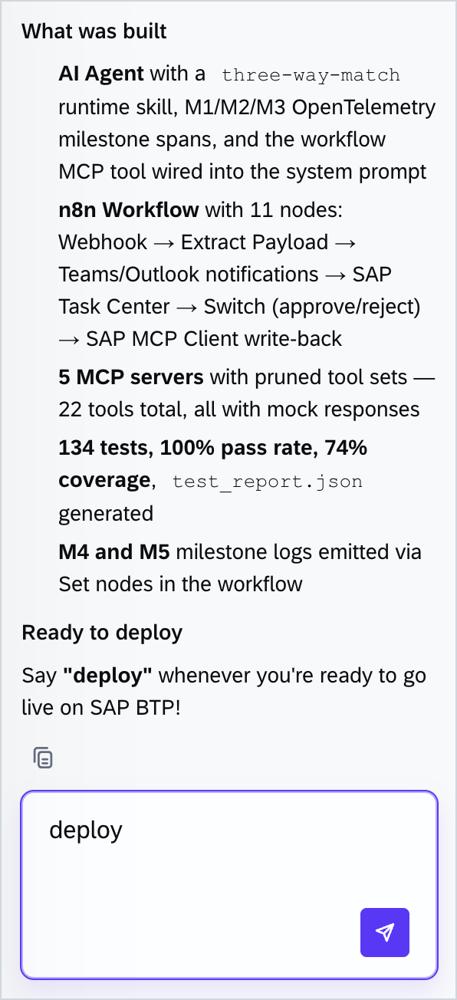

## Exercise 3.2 - Deploy and Test the Solution

After completing these steps you will have deployed the solution and run a full end-to-end test through the approval workflow.

1. A **"Confirm Deploy Solution"** dialog appears for the **Invoice Payment Block Processing Agent**. Four S/4HANA connection pre-selections are shown (Supplier Invoice, Purchase Order, Goods Receipt Confirmations, Purchasing Info Record — all pointing to `my444255.s4hana.cloud.sap`). **Click "Deploy Now"**.
<br>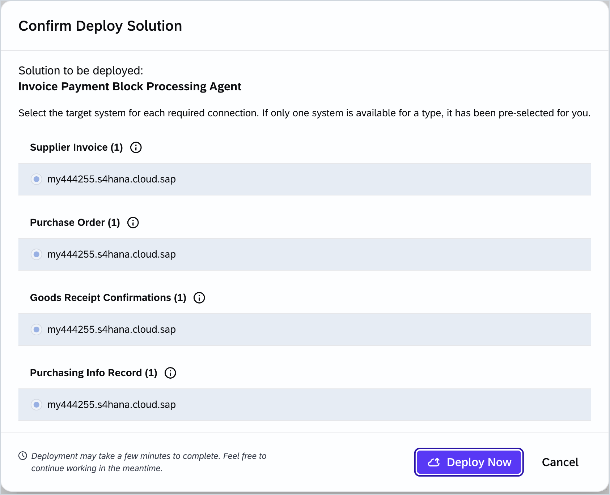

2. The **Manage** tab opens. Deployment is **In Progress** — all MCP Servers show **Running** while `invoice-payment-block-agent` shows **Integrating**. *(Review only — wait a moment for all assets to reach Running.)*
<br>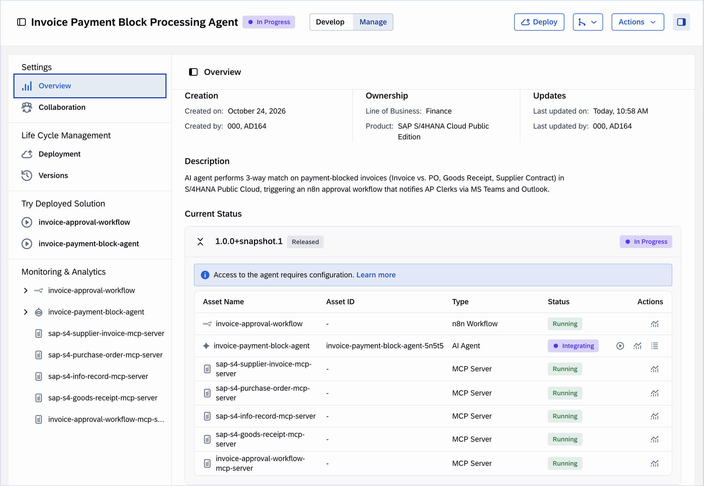

3. Once the solution status changes to **Running**, under **Try Deployed Solution**, **click `invoice-payment-block-agent`** to open the agent's test interface.
<br>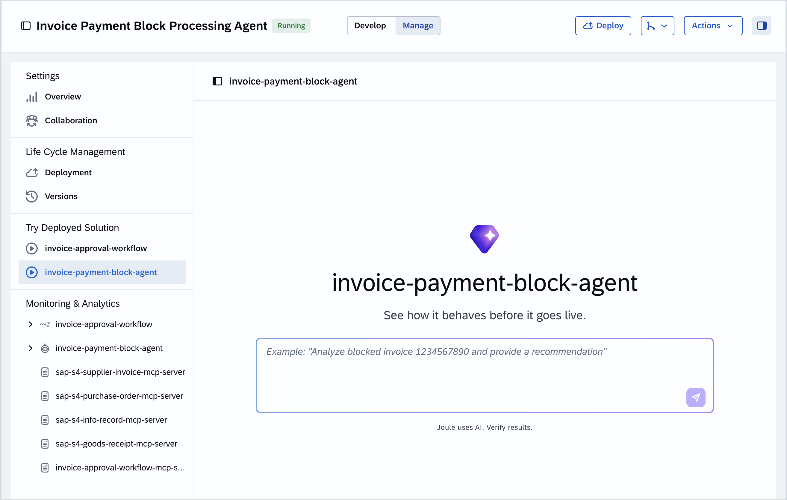

4. The **`invoice-payment-block-agent`** test interface opens with the hint *"Example: Analyse blocked invoice 1234567890 and provide a recommendation"*. **Type `analyse invoice 5108417282/2026`** and **send it** to test the agent standalone.
<br>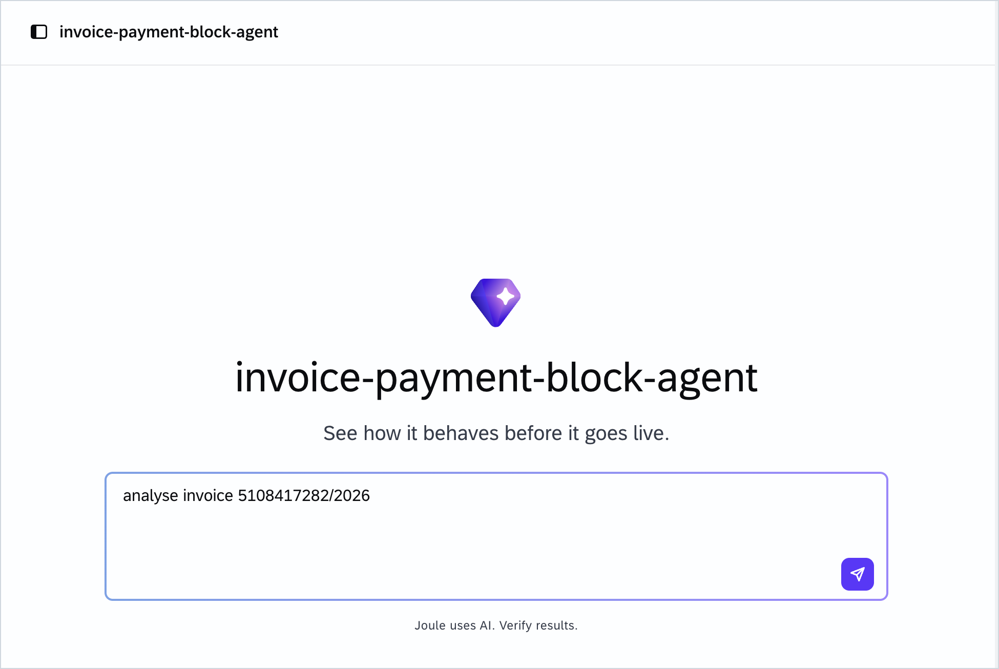

5. Now test the full end-to-end workflow. Under **Try Deployed Solution**, **click `invoice-approval-workflow`**. The Webagent lists the inputs the workflow expects: Invoice ID, AP Clerk Email, Recommendation, Confidence, Summary, and Discrepancies. *(Review only — familiarise yourself with the required fields.)*
<br>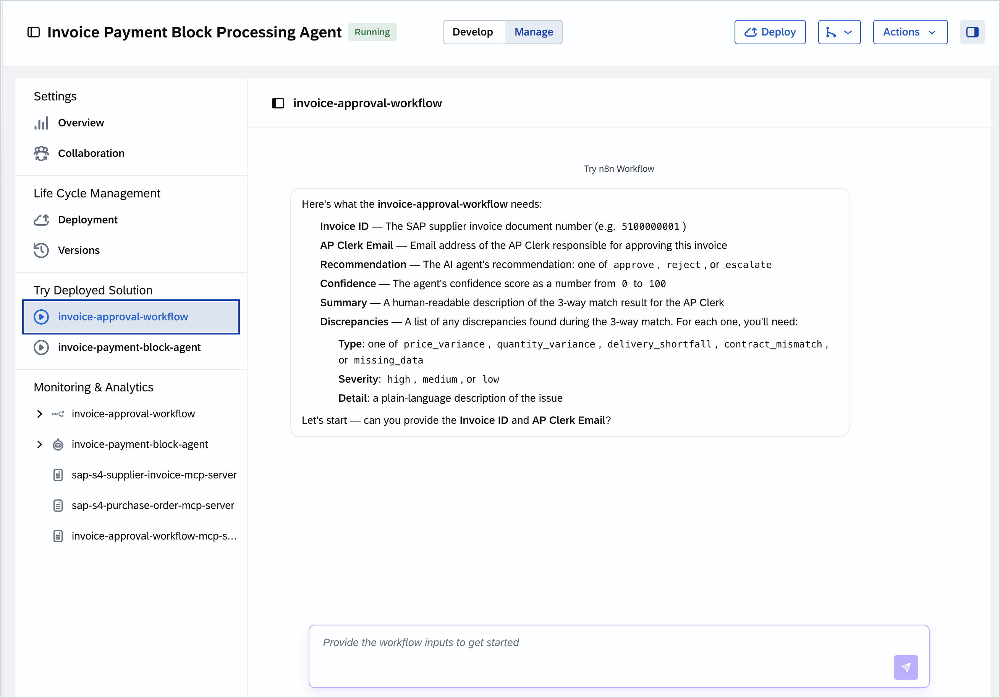

6. **Type `workflow test data`** and **send it** to ask the Webagent to generate sample pinned test data for the workflow.
<br>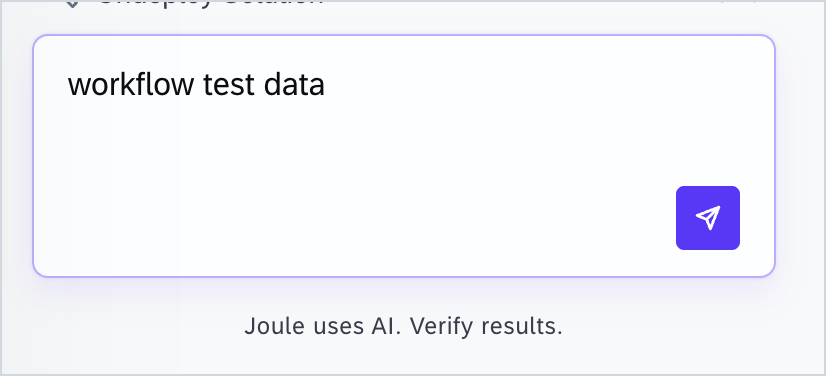

7. The Webagent confirms **"Workflow Test Data Added"** — two pinned data sets are now embedded: a Webhook entry point payload (invoice_id, recommendation, discrepancies, confidence, summary, clerk_id) and a SAP Task Center mock response (approved). *(Review only.)*
<br>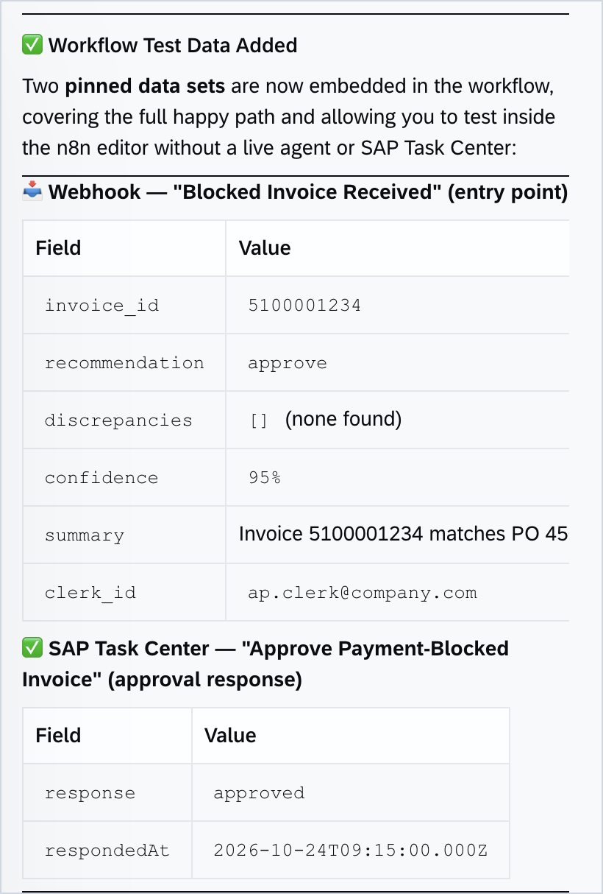

8. **Enter the following payload** in the message input and **send it** — replacing `ad164-000@bestrunsap.com` with your own email address:
    ```
    invoice_id: 5100001234
    recommendation: approve
    discrepancies: [] (none found)
    confidence: 95%
    summary: Invoice 5100001234 matches PO 4500007890. Vendor ACME Supplies, EUR 12,450.00 within tolerance. Payment block R1 can be released.
    clerk_id: ad164-000@bestrunsap.com
    ```
<br>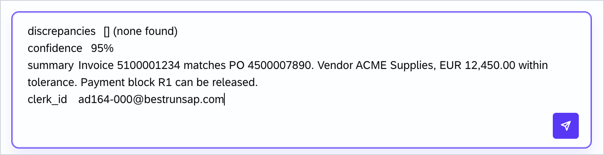
> **Not sure what your email address is?** Click the **avatar icon (your initials)** at the bottom-left of the navigation bar — your email is shown at the top of the profile panel.
<br>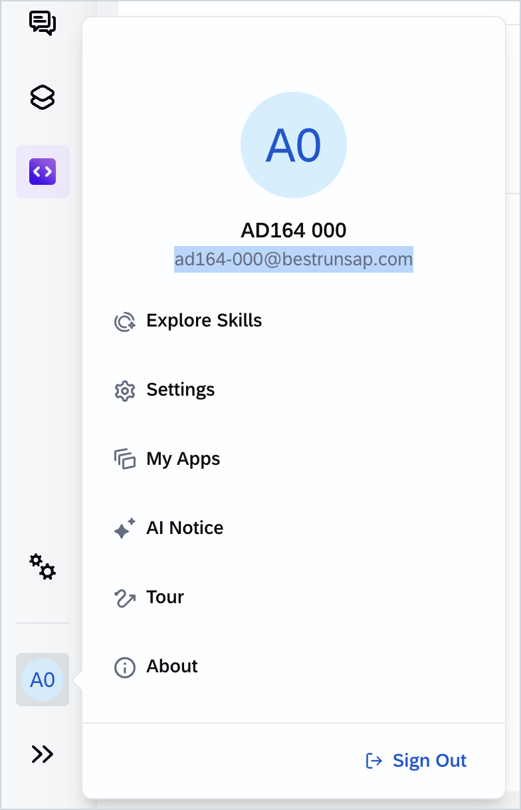

9. The Webagent shows a **summary table** of the workflow input (Invoice ID, AP Clerk Email, Recommendation: approve, Confidence: 95, Summary, Discrepancies: None). *(Review only — confirm the details are correct.)*
<br>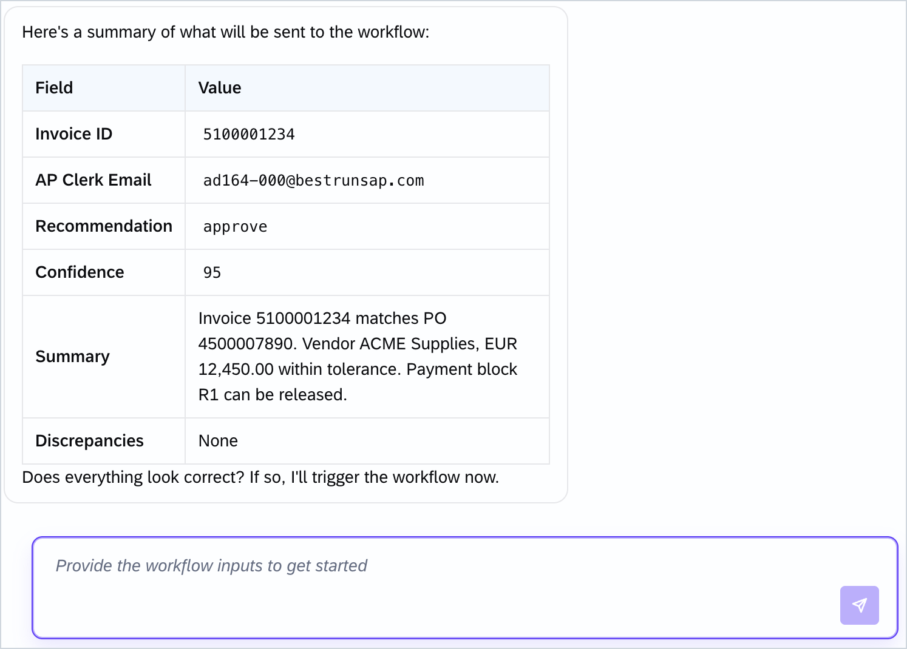

10. **Type `yes`** and **send it** to confirm, then **click "Execute Workflow"** to trigger the invoice approval workflow with your test data.
<br>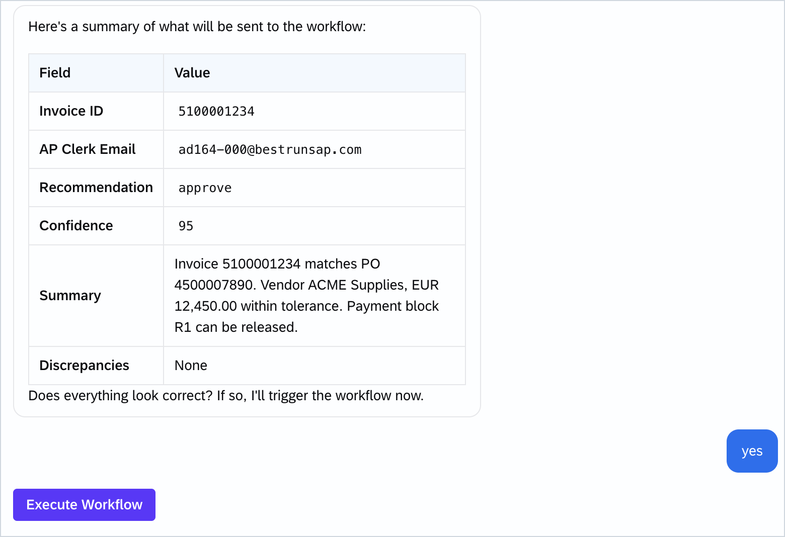

## Summary

You have successfully built, deployed, and tested an AP Invoice Payment Block Processing solution in Joule Studio. Starting from a plain-language intent, the Webagent created a Python AI agent with a 3-way-match skill, five custom MCP servers for S/4HANA APIs, and an n8n approval workflow — all from a single guided conversation. The agent analyses blocked invoices against procurement data and routes a structured recommendation to the AP Clerk via SAP Task Center, reducing manual review time from 5 days to under 1 day.
